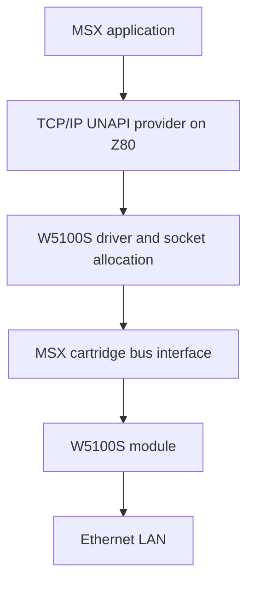
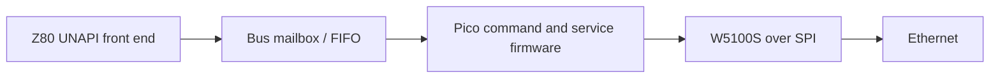

# Architecture

## Objective

Provide wired IPv4 networking to MSX software through the standard `TCP/IP`
UNAPI identifier. Initially target standard-speed MSX machines; qualify other
CPU speeds and machine families separately. BASIC/DOS initialization, minimum
RAM and supported DOS versions must be established during driver development.

This describes the direct-parallel alternative. The provider handles UNAPI
semantics, configuration, DNS and eventually DHCP. The W5100S handles supported
transport and network protocols. Hardware socket availability alone does not
implement an MSX API.

## Hardware alternatives

| Candidate | Benefits | Work required before selection |
| --- | --- | --- |
| W5100S indirect parallel bus with discrete decode/buffering | Follows the Net4CPC interface; no MCU firmware dependency | MSX decoding, voltage thresholds, bus timing, ROM and workspace design |
| Pico as a transparent register bridge | Programmable bus transport | GPIO budget, translation, deterministic response; services still run on Z80 |
| Pico as a command coprocessor owning W5100S | Small Z80 front end; DNS/DHCP and socket state in MCU RAM, following the ESP8266 reference | Bounded mailbox/FIFO interface, protocol, W5100S backend, reset/replay and firmware recovery |

The command-coprocessor option is recommended for the first software prototype,
following [the ESP8266 reassessment](ESP8266-REASSESSMENT.md) and the
[resource comparison](RESOURCE-BUDGET.md). Direct parallel remains the hardware
simplicity comparison; neither architecture is frozen. A Pico
register bridge and a Pico that owns sockets are different software designs.
A Pico connected over SPI cannot be assumed to finish each transaction within
an MSX read cycle; buffering, handshaking or validated wait-state logic is needed.
Keep outputs disabled until the interface is ready after power-on or reset.

The [W5100S integration notes](W5100S.md) add vendor constraints to both candidates,
including the SPI read erratum. Evaluate WIZnet's ioLibrary as a possible Pico
backend. The [pinned software review](SOFTWARE-REVIEW.md) identifies reusable
driver layers and required changes to timing, blocking behavior and API semantics;
the [resource budget](RESOURCE-BUDGET.md) now compares ROM, RAM, GPIO, bus glue
and transfer costs. Its allocations still require linked builds and measurements.

The command path uses short mailbox accesses and polled completion. Never hold
an MSX bus cycle while waiting for DNS, a TCP peer or a complete SPI transaction.
UNAPI ABI compliance belongs to the combined host/firmware implementation.
The [draft mailbox protocol](MAILBOX-PROTOCOL.md) defines eight relative register
offsets, two 16-byte hardware FIFOs, bounded whole-call frames, retained replies
and reset invalidation. It requires interface circuitry absent from the concept.
The [executable model](MAILBOX-MODEL.md) tests those transport rules and selected
TCP/UDP semantics with a fake backend. It supplies fixtures for the firmware
prototype; it does not qualify the bus circuit or the full UNAPI implementation.

## Bus mapping decision

Net4CPC's `FD20h`–`FD23h` ports are CPC-specific and are not an MSX allocation.
Compare these options before assigning public addresses:

- A slot-selected memory window containing four indirect registers. This avoids
  global I/O port allocation, but must coexist with ROM and MSX slot switching.
- A decoded I/O window. This simplifies some driver accesses, but requires a
  conflict audit, a defined high-byte decoding policy and a multi-cartridge policy.

For the command-coprocessor option, map mailbox/status/data registers instead of
assuming the four W5100S indirect registers remain the host interface.
The draft favors a slot-selected memory window for the prototype; its base
address and decoder remain unassigned.

For the memory option, ROM and peripheral read enables must be mutually
exclusive. For the I/O option, do not assume `/SLTSL` selects an I/O transaction.
Reject interrupt-acknowledge cycles in I/O decoding. No address is reserved yet.

## Software boundaries

1. Bus access primitives: register reads/writes and block transfers.
2. W5100S driver: reset, socket commands, buffer rings and timeout handling.
3. Network services: configuration, shared socket allocation, DNS and DHCP.
4. UNAPI provider: discovery, register ABI, capabilities and error translation.
5. Diagnostic/configuration utilities and application compatibility checks.

In the coprocessor alternative, layers 2–3 run on the Pico and layer 4 is split
between a Z80 ABI front end and firmware command handlers. Only the Pico owns
W5100S socket/register state during normal operation. Do not expose concurrent
raw register access that bypasses its allocation and synchronization.

Serialize indirect address/data sequences against other callers and interrupt
handlers. The Pico draft uses one mailbox caller and autonomous MCU service
progress, allowing a local `TCPIP_WAIT` once that independence is proven. Direct
parallel still needs a bounded timer/WAIT service design. Neither path may rely
on an interrupt-driven counter as its only escape from a polling loop.

A ROM provider is the intended cartridge experience. A RAM-loaded diagnostic or
development provider may precede it. ROM sizing, bank switching and persistent
configuration are open decisions; page-3 workspace must be allocated without
corrupting BASIC, DOS or another extension's hooks. Initial allocation targets
are a 16 KiB ROM for either candidate, 512 bytes of new host workspace for the
Pico front end, and 4 KiB (static IP/DNS) or 6 KiB (including DHCP) for direct
parallel. These are build acceptance targets, not established requirements.

## Scope boundaries

Ethernet UNAPI is a separate raw-frame API, not a prerequisite for TCP/IP UNAPI.
Defer it until socket/raw-frame ownership and coexistence have been designed.
IPv6, TLS, W6100 support and accelerated MSX operation are outside the first
milestone. Do not inherit W6100 compatibility merely because Net4CPC mentions it.
