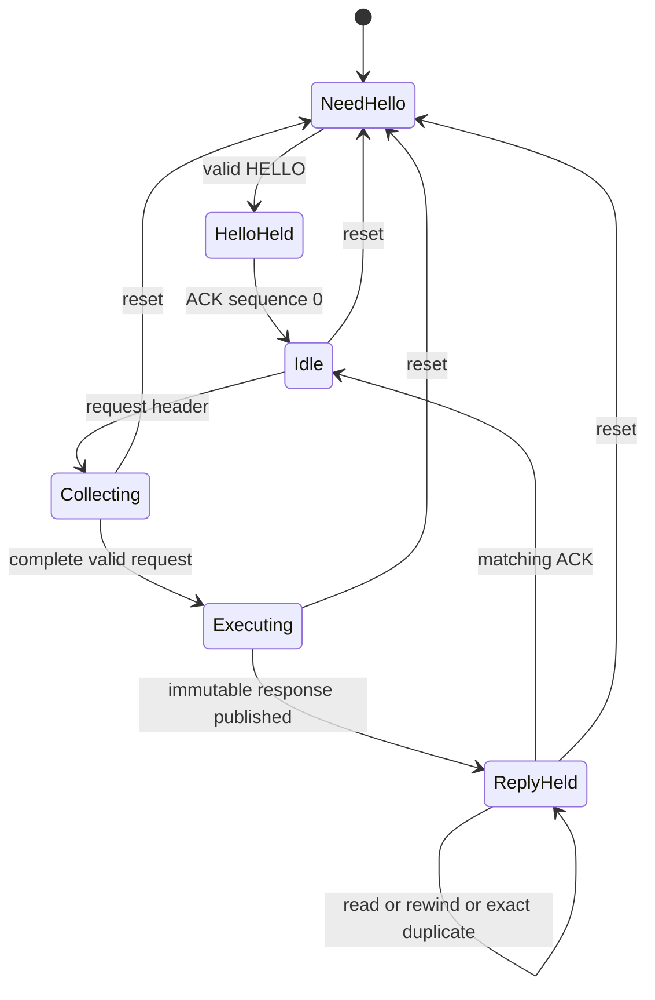

# MSX–Pico mailbox proposal

Draft 1, 2026-10-27. This specifies the first command-coprocessor prototype; it
does not select the final cartridge architecture or allocate an MSX address.
A [host-side model](MAILBOX-MODEL.md) now exercises the logical transport and
selected TCP/UDP semantics; firmware and interface circuitry are not implemented.
Compare its costs with direct parallel access
in [Resource budgets](RESOURCE-BUDGET.md), and its source adaptation requirements
in [Software review](SOFTWARE-REVIEW.md).

The Pico exclusively owns the W5100S. The Z80 implements discovery, the UNAPI
register ABI, slot-safe caller-memory access and transport recovery. Network
services progress on the Pico even while the host is paused. There is one host
caller and one outstanding command; a timer hook must not enter the mailbox
while a foreground call owns it. Do not advertise interrupt-call reentrancy.

## Prototype limits

All numbers in this table are proposed limits, not measured performance.

| Resource | Draft limit |
| --- | --- |
| Hardware FIFO depth | 16 bytes in each direction, independently clocked |
| Frame | 16-byte header + at most 2,080 payload bytes + 4-byte CRC = 2,100 bytes |
| Call payload | 32-byte call record + at most 2,048 data bytes |
| Outstanding requests / retained replies | One / one |
| TCP output capacity per application socket | 2,048 bytes; advertise actual free capacity |
| Maximum IP datagram, including IP/transport headers | 1,500 bytes in each direction; no fragmentation |
| Maximum UDP application payload | 1,472 bytes with the 20-byte IPv4 and 8-byte UDP headers |
| Host-name input | At most 255 characters followed by NUL; scan at most 256 bytes |
| Application sockets | Three shared by TCP/UDP; hardware socket 3 reserved for services |
| W5100S allocation | 2 KiB TX and 2 KiB RX per socket, including the service socket |

Use a whole-call frame instead of a multi-command upload protocol. A TCP send
larger than current output capacity returns `ERR_BUFFER` before any data is
enqueued. A UDP send larger than the advertised datagram limit returns
`ERR_LARGE_DGRAM`. Never silently split UDP or partially accept a TCP send.
The host validates lengths before copying; the Pico independently validates
them before acting. Limits must also hold for zero-length transfers.

## Bus contract

Prefer a slot-selected memory window for the experiment. The following offsets
are relative to an **unassigned** base. ROM output enable must exclude this
window. An I/O variant would require a separate conflict/decode review.

| Offset | Read | Write |
| --- | --- | --- |
| `0` | `STATUS` | Reserved |
| `1` | Zero | `CONTROL` |
| `2` | `TX_FREE`, 0–16 bytes the host may write | Reserved |
| `3` | `RX_COUNT`, 0–16 bytes the host may read | Reserved |
| `4` | Pop one Pico-to-host FIFO byte | Push one host-to-Pico FIFO byte |
| `5` | Protocol major, `01h` | Reserved |
| `6` | First latched `FAULT` code | Reserved |
| `7` | Signature, `4Eh` | Reserved |

`STATUS` bits: 0 controller ready; 1 RX count nonzero; 2 TX space nonzero;
3 reply retained; 4 command executing; 5 fault latched; 6 session active;
7 control operation busy. Reserved writes are ignored; undefined control values
fault. The signature identifies the interface, not working networking.
The interface logic keeps status/signature readable during Pico boot, with
ready/session-active low and both counts zero. Only reset control is accepted
until ready; data accesses cannot enqueue work for a later boot session.

`CONTROL=01h` rewinds the retained reply. It synchronously asserts control-busy,
stops its producer, flushes the RX FIFO and resets the reply cursor. Busy clears
only when new reads will start at byte zero. It neither re-executes the command
nor acknowledges the reply. Use only with reply-retained set. No other host
reads/writes of `DATA` are allowed until control-busy clears.

`CONTROL=80h` resets the session. It has priority in every state, including a
fault or an unfinished control operation. Hardware immediately clears session
active, flushes both FIFOs and prevents acceptance of old frames. Firmware
quiesces the backend, closes **all** owned sockets and discards pending work and
replay state before making the controller ready for a new handshake. This must
also work when the firmware needs a watchdog reset. It is not an ordinary TCP
close, and applications lose their connections.

The interface logic, rather than a firmware interrupt handler, must acknowledge
each MSX access within the qualified bus timing. A credit read reserves that
many FIFO accesses for the sole host: only the host can spend TX credit or
remove RX bytes. Firmware may increase the available counts. Reset is the
exception, and invalidates the complete transfer. Poll status again after each
burst of at most 16 bytes. Do not use an unlimited `OTIR`/copy loop.
Cross-clock count readings may conservatively underreport availability; they
must never overreport it or forget bytes the host already spent/removed.

An empty read returns `FFh` and latches a fault; a full write is dropped and
latches a fault. Neither may stall a bus cycle or silently continue processing.
Faults stop new command execution until reset. Proposed fault codes are 1 FIFO
misuse, 2 invalid frame/CRC/length, 3 session or sequence mismatch, 4 conflicting
duplicate, 5 invalid control, and 6 backend/watchdog failure. Zero means none.
Preserve the first fault for diagnostics until the reset control is accepted.

Both FIFO storage and count synchronization are hardware requirements, not
claims that the current KiCad concept contains them. A CPLD/FIFO interface or
another independently qualified implementation must provide them. FPGA/CPLD
part, clock crossing, propagation time and voltage translation remain open.
Pico GPIO/PIO capacity alone is not timing evidence.

## Frame format

Integers below are unsigned and little-endian. IPv4 addresses in parameter
blocks remain four octets in network order. Frames are length-delimited; there
is no escaping or scanning for a magic value after an error.

| Byte offset | Size | Meaning |
| --- | --- | --- |
| 0 | 2 | Magic bytes `4E 34` (`N4`) |
| 2 | 1 | Protocol major, 1 |
| 3 | 1 | Kind: 0 HELLO, 1 REQUEST, 2 RESPONSE, 3 ACK |
| 4 | 4 | Host-assigned session number, nonzero |
| 8 | 4 | Sequence: 0 for HELLO; normal calls start at 1 |
| 12 | 1 | Opcode: UNAPI function number for calls; `FFh` for HELLO |
| 13 | 1 | Transport status: zero in HELLO/REQUEST/ACK |
| 14 | 2 | Payload length, 0–2,080 |
| 16 | Variable | Payload |
| 16 + length | 4 | CRC of header and payload |

Use CRC-32 with reflected polynomial `EDB88320h`, initial accumulator
`FFFFFFFFh`, processing each byte least-significant bit first, and final XOR
`FFFFFFFFh`. Append the resulting integer little-endian. The check value for
ASCII `123456789` is `CBF43926h`. CRC detects transfer corruption; it is not
authentication or a substitute for sequence validation.

A normal RESPONSE echoes the session, sequence and opcode. Transport status 0
means it contains a call record, whose A byte is the **public UNAPI error**.
Transport status 1 means unsupported transport opcode and has no payload.
All other status values are reserved. Invalid framing, CRC, session or length
latches `FAULT` without executing a new command. A transport error must never
be returned verbatim as a UNAPI error number.

The parser checks the fixed header and length before accepting body bytes.
It retains at most one complete request and one complete response. An incomplete
request can remain suspended indefinitely without consuming more memory or
executing any operation. Reset is the escape path; there is no speculative
execution as payload bytes arrive.

### Call record and pointer handling

Normal REQUEST and successful-transport RESPONSE payloads start with this
32-byte record. Unused fields/auxiliary bytes must be zero.

| Record offset | Size | Meaning |
| --- | --- | --- |
| 0–7 | 8 | A, F, B, C, D, E, H, L, in that byte order |
| 8 | 2 | IX |
| 10 | 2 | IY |
| 12 | 1 | Auxiliary length, 0–16 |
| 13 | 1 | Reserved, zero |
| 14 | 2 | Inline data length, 0–2,048 |
| 16 | 16 | Auxiliary parameter or result block, zero-padded |
| 32 | Variable | Inline data; frame payload length must equal 32 + data length |

Only registers defined as inputs/outputs by the selected UNAPI routine are
meaningful. Request A equals the opcode. The host saves original registers,
clears pointer fields before transmitting them and restores registers that the
public ABI preserves. The Pico never reads an MSX address or returns an MCU
pointer. Host pointers and slot context stay in the Z80 workspace. F and IY are
reserved as zero for the initial call set unless the normative ABI needs them.

| Public call | Marshaling for the initial profile |
| --- | --- |
| 0, implementation information | Local ROM strings/version; no remote pointer |
| 1–3, capabilities/configuration/state | Register inputs and outputs; maintain a host snapshot for failure handling |
| 6, DNS start | Inline name including NUL, no auxiliary block; abort-only request has no name and ignores its pointer |
| 7, DNS result | Registers only; a result-clear request is an effectful call and uses replay protection |
| 8–10, UDP open/close/state | Registers only |
| 11, UDP send | Eight-byte UNAPI destination/length block in auxiliary data; exactly that many inline payload bytes; host HL/DE pointers cleared |
| 12, UDP receive | Input DE is copy limit; HL pointer cleared. Reply registers carry original length and sender; inline length is the actual copied length |
| 13, TCP open | First 11 bytes of the UNAPI parameter block in auxiliary data; HL pointer cleared; TLS/passive requests rejected according to advertised capabilities |
| 14–15, TCP close/abort | Registers only; preserve transient/resident and handle-zero semantics |
| 16, TCP state | HL pointer cleared; reply always supplies the eight-byte connection block on success. Host copies it only if caller requested it |
| 17, TCP send | Input HL is length, DE pointer cleared; inline length must equal HL |
| 18, TCP receive | Input HL is requested length, DE pointer cleared; reply BC and inline length agree |
| 26, manual IP configuration | Register inputs/outputs; destructive reconfiguration requires its own UNAPI semantics, not a transport reset |
| 29, wait | Local success with interrupts enabled, once autonomous Pico service progress is proven |

Other defined functions still need their specified capability-dependent behavior
in the host dispatcher; they are not implicitly implemented by the transport.
In particular, configuration queries can have mandatory behavior even when a
related set operation is unsupported. Undefined public function numbers use
the core UNAPI preservation rule locally. Do not forward them as remote calls.
Numeric DNS parsing remains available without a working Pico. The host tracks
whether its current DNS result is local, a pending remote query or a completed
remote query. Function 7 contacts the Pico only for the pending-remote case;
otherwise it returns/clears the host's cached result. A successful new lookup
replaces that state; an error must not install a new cached answer. Preserve
UNAPI's flag/error ordering when replacing an in-progress query. Abort-only
returns success with B=0; if a query was pending, cache cancellation error 18
instead of interpreting B=0 as a newly started query.
Thus a numeric result obtained offline cannot be overwritten by an older Pico
result after reconnecting. When connected, numeric and abort requests still
reach the Pico to cancel/replace any previous remote query consistently.

## Session, acknowledgment and replay



The diagram omits faults: a fault stops acceptance, and only reset exits it.
Reset is also valid during HELLO and firmware boot. Every path into NeedHello
includes FIFO flushing and backend quiescence before another handshake.

1. On installation/recovery the host issues reset, invalidates every old handle
   and waits with a finite polling bound for controller-ready. Ready is low
   during reset processing. The firmware may never print boot banners into the
   binary mailbox.
2. The host increments its session counter and sends HELLO with sequence 0,
   opcode `FFh`, zero status and zero payload. The counter must not wrap within
   one driver lifetime. A restarted host may restart the counter only after
   reset has discarded all previous transport and network state.
3. The HELLO RESPONSE uses status 0 and a special 16-byte payload: maximum frame
   payload `u16=2080`, maximum data `u16=2048`, TX/RX FIFO depths `u8=16,16`,
   hardware/application socket counts `u8=4,3`, IP datagram limit `u16=1500`,
   followed by six zero reserved bytes. This is not a call record. Draft 1
   requires these exact limits; reject incompatible values instead of guessing.
   Only NeedHello accepts a new HELLO. An exact repeat while HelloHeld reuses
   its retained response; it does not reset the backend or create a new session.
4. A matching ACK has zero payload/status and echoes opcode/session/sequence.
   Acknowledging HELLO sets session-active. The host then starts sequence 1.
   Unexpected device reset immediately clears ready/session-active and flushes
   the FIFOs, through hardware gating even before new firmware starts.
5. A request is accepted only at the next expected sequence. Once its complete
   frame passes validation, reserve the response buffer and record execution
   ownership **before** making any socket or network change.
6. Keep the original request bytes and the completed response immutable until
   ACK. An exact duplicate at the current sequence does not execute again,
   including while the original is executing. Compare all bytes, not just CRC.
   A different request with the same sequence faults. A duplicate does not move
   the response read cursor; the host uses rewind when needed.
7. Reading the final reply byte is not an ACK. After validating the entire
   response and completing its caller-memory copy, the host sends ACK. The Pico
   releases request/reply storage, records the last acknowledged sequence and
   advances the expected sequence. Flush any unread RX FIFO tail at this point,
   so it cannot prefix the next response. The host waits for reply-retained to clear
   before issuing a new request.
8. An exact duplicate of the last ACK is harmless, even after another request
   starts. Remember its opcode too. An older request is rejected, not replayed
   after its reply storage has been released. A repeated ACK must not flush or
   move the current reply cursor. Any future or unrelated sequence
   faults. Reset before sequence `FFFFFFFFh`; there is no sequence rollover.

ACKs use the TX FIFO, independently of a full RX FIFO. A partial/corrupt ACK
cannot free a response. Parser scratch must distinguish an ACK from a duplicate
without overwriting retained request bytes. There is no third command queue.

The host retries reply reads, not uncertain network actions: rewind and reread
at most twice after the initial attempt. For a receive, keep the original caller
address and rewrite the same region on replay; never append it twice. Validate
header, length and call metadata before copying any inline bytes, and CRC before
ACK/success. If a payload CRC fails after a streamed copy, that caller region may
already contain bytes; rewrite it on retry. On terminal transport failure no
successful receive is reported, and the caller must disregard the affected
region. This avoids requiring another 2 KiB MSX staging allocation.

Host pauses do not expire a partial request or retained response. Pico service
work continues and memory use stays fixed. A newly started driver recovers an
abandoned exchange with reset. There is deliberately no automatic re-execution
after reset, power loss or watchdog failure: a send might have reached the peer
before its result was lost. Replay protection applies within a live session;
it is not a promise of exactly-once network delivery across resets.

### Handshake wire examples

These complete frames use session 1 and sequence 0. Line breaks separate header,
payload (if present) and CRC; they are not transmitted. They are byte fixtures
for future independent encoders/decoders, not a successful hardware exchange.

HELLO, 20 bytes:

```text
4e 34 01 00 01 00 00 00 00 00 00 00 ff 00 00 00
5e 24 33 7c
```

HELLO RESPONSE, 36 bytes:

```text
4e 34 01 02 01 00 00 00 00 00 00 00 ff 00 10 00
20 08 00 08 10 10 04 03 dc 05 00 00 00 00 00 00
cc f9 3b 0a
```

ACK, 20 bytes:

```text
4e 34 01 03 01 00 00 00 00 00 00 00 ff 00 00 00
90 48 f9 c1
```

## Network semantics and bounded progress

The public behavior comes from the [pinned TCP/IP UNAPI 1.1 specification][unapi].
These choices apply equally to a future direct-parallel implementation:

- **TCP send:** validate the whole request and free output capacity, copy all
  bytes into owned TX storage, then publish the W5100S write pointer/command.
  Before that commit point an error must enqueue nothing. Return success when
  enqueued, without waiting for the peer's ACK. Keep free capacity at zero while
  an incompatible send command is pending. A zero-length send on a valid
  connection succeeds; unsupported PUSH/urgent flags follow the API's ignore
  rules, while unused flag bits remain invalid.
- **TCP receive:** snapshot available bytes once, at most the socket's 2 KiB RX
  capacity. Copy `min(requested, snapshot)` into the response before advancing
  the W5100S RX pointer. Retain those bytes for replay. Do not keep consuming
  newly arriving data within the same call. No data is success with BC=0.
- **UDP receive:** capture one oldest complete record, its original length and
  sender; return `min(copy_limit, original_length)` bytes. Advance past the
  entire eight-byte W5100S record header and datagram, including the discarded
  tail. DE=0 still consumes the datagram; DE=FFFFh retrieves it all. BC remains
  the original length. Oversized/malformed records need bounded discard/recovery,
  never an unchecked read into the reply buffer.
- **UDP send:** stage one whole datagram and issue exactly one SEND. Unlike TCP
  enqueue, UNAPI expects prompt datagram transmission and has no `ERR_BUFFER`
  result here. The initial handler may wait for SEND_OK/TIMEOUT with a finite
  network deadline while the Pico continues servicing other sockets. Do not
  report success for an indefinitely queued datagram. Qualify zero-byte UDP
  sends on W5100S before advertising UDP support.
- **DNS and TCP open:** return after starting the operation; expose completion
  through their state calls. Leave blocking-DNS/blocking-open feature bits
  clear. DNS names, compression pointers, packet ends and retries need bounded
  parsing and storage. DNS cancel and result-clear must be replay-safe too.
- **Services:** reserve hardware socket 3 permanently, leaving three application
  handles. Serialize DNS and future DHCP on it. DHCP renewal takes priority
  before admitting another DNS server query; an accepted query can wait for
  the service socket within its overall deadline. Expiry returns the documented
  DNS timeout (17), not an invented public resource error. Numeric DNS needs no
  socket. Never evict an application connection for an internal service.

Use fixed storage and bounded work per scheduler visit. A command-register or
stable-size read must have a deadline even when ioLibrary provides a busy loop.
Provisional watchdogs are 100 ms for a local chip operation, 500 ms for backend
reset/initialization, 2 s for UDP completion, 10 s total for DNS including resource
wait, and 30 s for TCP establishment. These are prototype policy values to
qualify, not WIZnet guarantees. TCP user-timeout support stays unadvertised
unless actually implemented. DHCP lease deadlines remain separate protocol timers.

Host reply waits allow the applicable command deadline plus transfer/scheduling
margin. Start with a 3 s host wall-clock target for a complete foreground call,
including a bounded recovery attempt; DNS/TCP establishment continue in the
background. Every call also has a shared ceiling of 1,048,576 status/count polls
across handshake, transfer, replay and ACK. Do not replenish that counter after
each byte or retry. This fallback is independent of H_TIMI; interrupts being
disabled must not cause a hang. All copy/CRC loops have explicit byte bounds.
Calibrate the poll ceiling against the assembled routine and named MSX clock
before networking is enabled: it is a finite iteration limit, not a proven
3 s wall-clock guarantee when interrupts stop. On exhaustion, latch the host
offline and issue reset without starting another blocking recovery loop in the
same call. Never extend a deadline merely because a busy bit remains set.

On unrecoverable transport/backend failure, invalidate all application handles
and reset the session. Existing-handle operations can then use `ERR_NO_CONN`;
failed opens use their defined no-resource result, and no-fail information/WAIT
calls still honor their ABI. Report network unavailable and zero free resources
until recovery. An interrupted DNS query becomes DNS network-loss error 19.
Keep local identity, numeric DNS and required configuration queries usable.
The host needs a per-function failure table; it must not return a blanket
`ERR_NO_NETWORK`, since several functions do not permit it. Exhaustive register
fixtures for that table are a prototype acceptance requirement.

## Required prototype evidence

Before choosing this architecture, demonstrate:

- Frame boundary lengths 0, 31/32, 2,080/2,081; inconsistent inline length;
  partial header/body/CRC; bad magic/version/CRC; out-of-range auxiliary length.
- FIFO boundaries 0/1/15/16/17, independent producer/consumer pauses, ACK with a
  full RX FIFO, credit stability and bus release during firmware reboot.
- Lost reply, truncated reply, duplicate request during/after execution, a
  conflicting duplicate, repeated ACK, and an old request after ACK. Count
  backend side effects to prove one execution within a session.
- Reset during collection, execution, replay and ACK, plus a host restart while
  the Pico remains powered. Old handles/frames must never reach the new session.
- TCP sends of 0/512/2,048/2,049 bytes, inadequate free space with no partial
  enqueue, receive replay, and close/abort of transient versus resident handles.
- UDP lengths 0/1/1,472/1,473, DE=0/short/FFFFh receive, RX ring wrap, replay of
  truncated receive followed by another datagram, and all four hardware sockets.
- DNS input boundaries and malformed/compressed responses, service contention,
  unavailable peers, a stuck chip register and host waits with timer progress
  stopped. Record API results and maximum observed latency separately.

The [host-side model and coverage report](MAILBOX-MODEL.md) now exercise the
transport cases and selected TCP/UDP semantics. DNS/DHCP, the full public ABI
and all hardware-dependent cases above remain open. Qualify the MSX bus and
Pico/W5100S timing on hardware; model results do not establish electrical timing
or actual firmware size.

[unapi]: https://github.com/salvogendut/MSX-UNAPI-specification/blob/eb7e978c4c2133bf5d31a470281940f5ee44c4f5/docs/TCP-IP%20UNAPI%20specification.md
