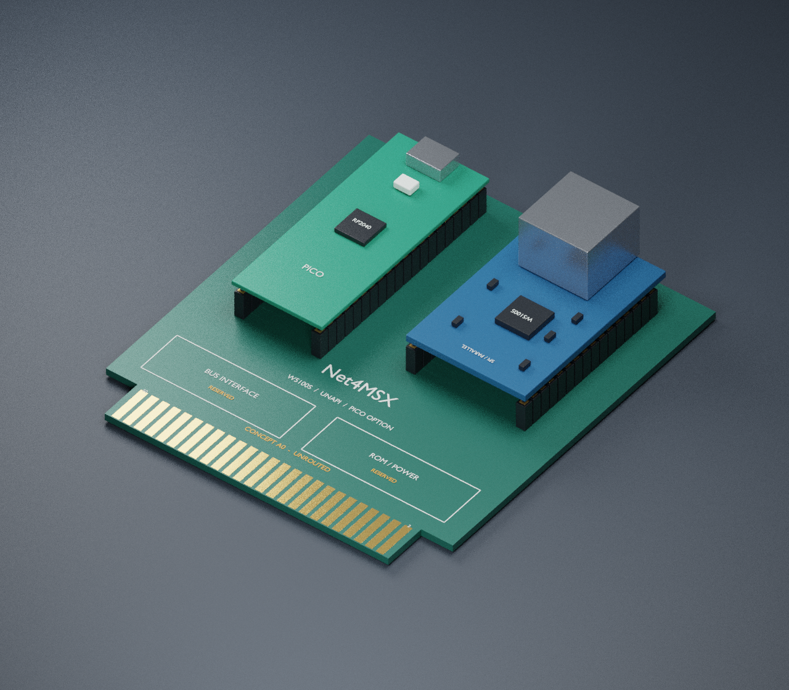

# Net4MSX KiCad concept A0

Open [Net4MSX.kicad_pro](Net4MSX.kicad_pro) with KiCad 6 or later.

- [Schematic](Net4MSX.kicad_sch): self-contained connector/module symbols and
  proposed Pico-to-W5100S SPI connections.
- [PCB](Net4MSX.kicad_pcb): editable placement, 50-contact edge, module/Pico
  footprints, board outline and reserved bus/ROM/power areas.
- [3D mockup](renders/Net4MSX-concept-3d.png) and
  [top view](renders/Net4MSX-concept-top.png).
- [Blender scene](Net4MSX-concept.blend): editable geometric rendering.
- [Pin map](pin-map.csv): schematic/PCB mapping for review.
- [Footprint library](Net4MSX.pretty), [symbol library](Net4MSX.kicad_sym)
  and simple [3D models](models).



## What this design establishes

The module footprint is adapted from Net4CPC's generic W5100S SPI/parallel
module, as requested by the user. It has two rows of 16 pad positions, 2.54 mm
pitch and 25.4 mm row spacing. The source's eight unassigned pad positions
(13–20) are preserved as unconnected pads; their physical purpose must be checked
on the actual module. They are not treated as additional W5100S signals.

The concept illustrates the Pico command-coprocessor alternative described in
[Architecture](../docs/ARCHITECTURE.md). This is not a final selection against
direct parallel access. Proposed SPI wiring is:

| Pico GPIO (physical pin) | Net4CPC module pad | Signal |
| --- | --- | --- |
| GP16 (21) | 32 | MISO |
| GP17 (22) | 29 | /CS |
| GP18 (24) | 30 | SCLK |
| GP19 (25) | 31 | MOSI |
| GP20 (26) | 12 | /RESET |
| GP21 (27) | 11 | /INT |

Module MODE (28) is assigned ground for SPI. /RD and /WR (1, 2) are assigned
the module's 3.3 V rail. Parallel data pads have separate unused nets. Module
and Pico 3.3 V rails are separate; their regulator outputs are not tied together.
Pico signal numbering follows the
[official Pico pinout](https://datasheets.raspberrypi.com/pico/Pico-R3-A4-Pinout.pdf).

The carrier envelope is a **proposed 80 × 90 mm**, 1.6 mm board with a
65.44 mm contact tongue. It is not a measured replacement for the diagnostic
cartridge shell. The 25-per-side contact pitch and approximate contact geometry
were checked against the diagnostic cartridge Gerbers. Board outline, insertion
depth, edge numbering/orientation and shell fit still need physical verification.
Component-side copper is F.Cu; looking at that side with the tongue down, the
even contacts run 50 to 2 from left to right. Back-side odd contacts share those
physical positions, 49 to 1 in the same top-view coordinates.

## Completion boundary

This is an **unrouted interface and placement concept, not a manufacturing
release**. The schematic intentionally leaves `5V_SLOT`, `MOD_5V_INPUT` and
`PICO_VSYS` separate. It does not yet implement supply protection, power
sequencing, USB backfeed prevention, pull-ups, boot-safe output enables, MSX
level translation, bus decoding, mailbox/FIFO, ROM or workspace circuitry.
Reserved areas on the PCB are planning annotations, not populated circuits.

The schematic uses passive interface symbols to describe pin mapping; an ERC
pass would not establish electrical correctness. No full ERC/DRC acceptance or
hardware test is claimed. There are no copper tracks or manufacturing Gerbers.

The 3D scene is generated from the PCB placement export, with simplified module,
RJ45, Pico and socket shapes. Small module components are illustrative. It is a
placement mockup, not a vendor-accurate mechanical model; connector height and
module clearances need measurement. KiCad also has local VRML placeholder models
for U1/U2 so its built-in 3D viewer can display the concept.

## Regeneration

Validation performed: KiCad 6 schematic opening, PCB/footprint reload, 122-pad
schematic/PCB/CSV agreement, distinct pad positions and expected header extents,
placement agreement with the render input, and visual inspection of both renders.

The checked-in CAD files open without the reference checkout. Regeneration uses
Python 3 with KiCad 6's `pcbnew` module and Blender 3.4:

```sh
python3 tools/generate_hardware.py --net4cpc /path/to/Net4CPC
blender -b --python tools/render_board.py
python3 tools/check_hardware.py
```

Run from the repository root. The generator overwrites the generated CAD files;
preserve any manual changes before running it. `placement.json` is produced from
the KiCad board and consumed by Blender, keeping footprint locations aligned.
See [NOTICE](NOTICE.md) for provenance and retained licenses.
